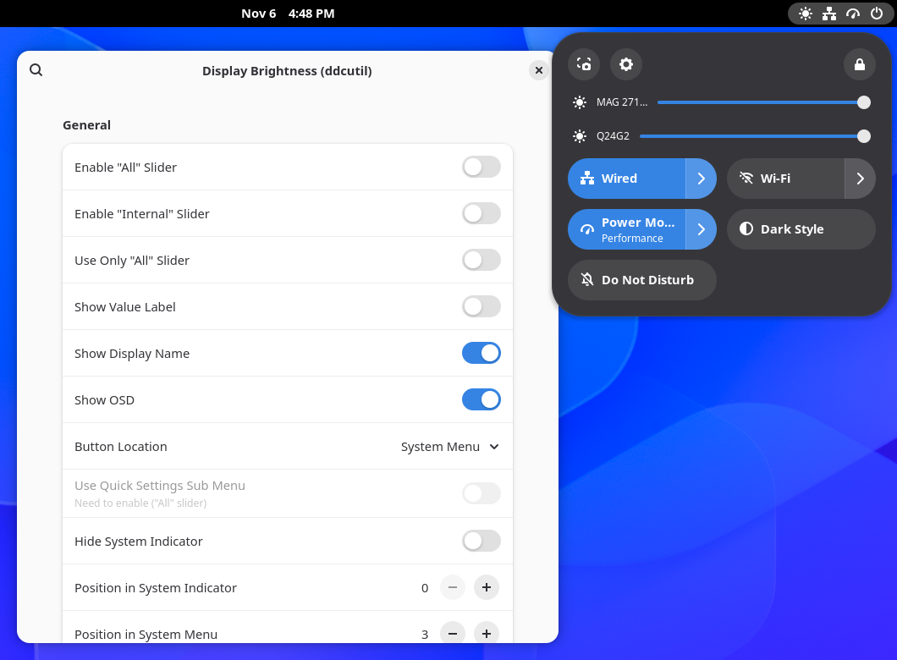
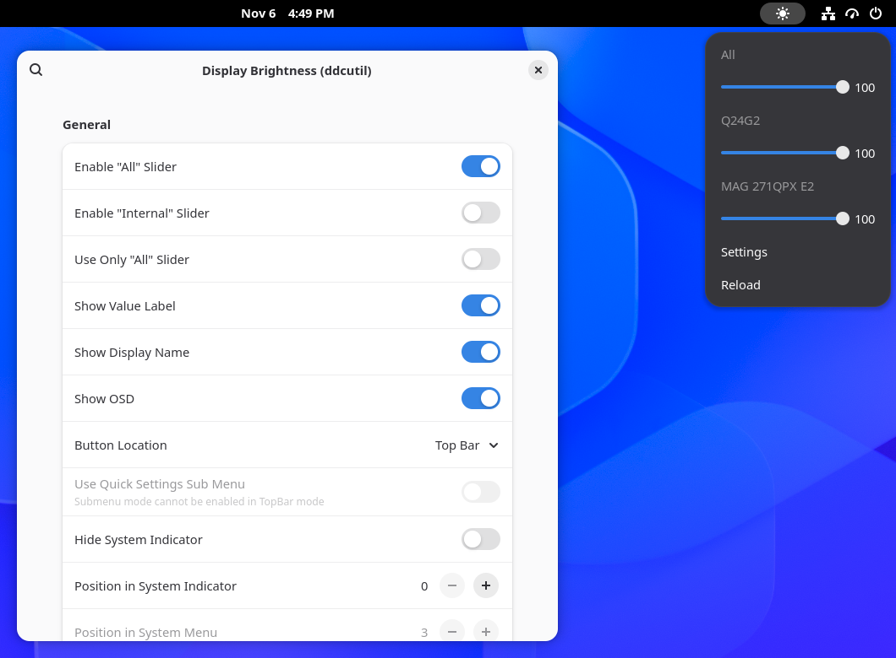
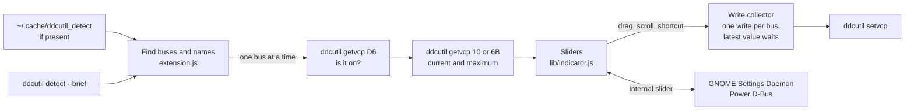

<div align="center">

# Display Brightness (ddcutil)

Brightness sliders for your external monitors, right in GNOME Shell

[Install](#installing) · [Set up ddcutil](#setting-up-ddcutil) · [Troubleshooting](#troubleshooting) ·
[Report a bug](https://github.com/Tim-van-Oudheusden/gnome-display-brightness-ddcutil/issues/new?template=bug-report.yml)

[](https://github.com/Tim-van-Oudheusden/gnome-display-brightness-ddcutil/actions/workflows/ci.yml)
[](#requirements)
[](LICENSE)
[](https://github.com/Tim-van-Oudheusden/gnome-display-brightness-ddcutil/commits/main)

</div>

<p align="center">
  
  
</p>

## Status

Maintained fork of [Brightness control using ddcutil](https://github.com/daitj/gnome-display-brightness-ddcutil) by
[@daitj](https://github.com/daitj), updated for GNOME 51. It has its own UUID,
`display-brightness-ddcutil@tim-van-oudheusden.github.io`, and is not on extensions.gnome.org yet: install it from
source or from a CI build ([Installing](#installing)).

## About

GNOME Shell only controls the brightness of a laptop's built-in screen. This extension adds a slider for every
external monitor that speaks DDC/CI, the protocol monitors use to take settings over the video cable, using
[ddcutil](https://www.ddcutil.com) to talk to them. The sliders sit in Quick Settings or in a menu of their own in the
top bar.

## Features

- **One slider per monitor.** Every display `ddcutil detect` finds and that answers DDC/CI gets its own slider, named
  after the monitor. Monitors that are switched off are skipped.
- **An "All" slider.** Moves every monitor at once, each in proportion to its current level. Use it beside the
  per-monitor sliders, as their parent in a Quick Settings submenu, or on its own. An "Internal" slider adds the laptop
  screen through GNOME Settings Daemon.
- **Quick Settings or top bar.** Put the sliders in the system menu, at a position you choose, or behind their own
  icon in the top bar. Optional value labels and the GNOME on-screen display show the level.
- **Keyboard and scroll.** <kbd>Ctrl</kbd>+<kbd>Brightness Up</kbd> and <kbd>Ctrl</kbd>+<kbd>Brightness Down</kbd> by
  default, in steps you set; scrolling over the indicator changes every monitor.
- **Gentle on the bus.** Each monitor gets one `ddcutil setvcp` at a time, and while one runs only the latest slider
  value waits, so dragging a slider doesn't queue up dozens of writes.
- **Tunable.** The ddcutil path, extra arguments and sleep multiplier, VCP code 10 (brightness) or 6B (white backlight),
  zero brightness, the display state check and verbose logging are all in the preferences.

## Requirements

- GNOME Shell 50 or 51
- [ddcutil](https://www.ddcutil.com), usable by your user without `sudo` ([Setting up ddcutil](#setting-up-ddcutil))
- Monitors with DDC/CI turned on (usually a setting in the monitor's own menu)

## Setting up ddcutil

If `ddcutil detect` already lists your monitors without `sudo`, skip to the check at the end: many distributions'
ddcutil packages give the logged-in user access to `/dev/i2c-*` through udev's `uaccess` tag.

1. Install `ddcutil` from your distribution.
2. Load the `i2c-dev` kernel module now, and at every boot:

   ```sh
   sudo modprobe i2c-dev
   echo i2c-dev | sudo tee -a /etc/modules-load.d/i2c.conf
   ```

3. Check that your monitor supports brightness control:

   ```sh
   sudo ddcutil capabilities | grep "Feature: 10"
   ```

4. Give the `i2c` group read and write access to the `/dev/i2c-*` devices with ddcutil's udev rule. For ddcutil 2.0
   and newer:

   ```sh
   sudo cp /usr/share/ddcutil/data/60-ddcutil-i2c.rules /etc/udev/rules.d
   ```

   On Fedora 40 and newer and on openSUSE Aeon, uncomment this line in the copied file:

   ```
   # KERNEL=="i2c-[0-9]*", GROUP="i2c", MODE="0660"
   ```

   Before ddcutil 1.4.0 the file was `/usr/share/ddcutil/data/45-ddcutil-i2c.rules`. More in ddcutil's
   [i2c permissions](https://www.ddcutil.com/i2c_permissions/) guide.

5. Create the `i2c` group and add yourself to it:

   ```sh
   sudo groupadd --system i2c
   sudo usermod -aG i2c "$USER"
   ```

6. Reboot.

Afterwards these must work without `sudo`; the extension runs the same commands:

```sh
ddcutil detect          # lists your monitors
ddcutil getvcp 10       # reads the brightness
ddcutil setvcp 10 100   # sets it to 100
```

## Installing

Pick one:

- **Download a CI build.** Every CI run uploads the packed extension as the `shell-extension` artifact. Open a recent
  run of the [`CI` workflow](https://github.com/Tim-van-Oudheusden/gnome-display-brightness-ddcutil/actions/workflows/ci.yml)
  (you must be signed in to GitHub), download the artifact, unzip it, and install the bundle inside:

  ```sh
  gnome-extensions install --force display-brightness-ddcutil@tim-van-oudheusden.github.io.shell-extension.zip
  ```

- **Build from source.**

  ```sh
  git clone https://github.com/Tim-van-Oudheusden/gnome-display-brightness-ddcutil.git
  cd gnome-display-brightness-ddcutil
  make install
  ```

Then log out and back in (on Wayland GNOME Shell only loads new extensions at login) and enable it:

```sh
gnome-extensions enable display-brightness-ddcutil@tim-van-oudheusden.github.io
```

### Coming from Brightness control using ddcutil

Disable the original extension first, or both will add sliders and claim the same keyboard shortcuts:

```sh
gnome-extensions disable display-brightness-ddcutil@themightydeity.github.com
```

Your settings carry over: both extensions use the GSettings schema
`org.gnome.shell.extensions.display-brightness-ddcutil`.

## Troubleshooting

### The screen freezes on the first start after boot

On some hardware the first `ddcutil detect` after a cold boot locks the whole system for a few seconds while it probes
the i2c buses. When the file `$XDG_CACHE_HOME/ddcutil_detect` (usually `~/.cache/ddcutil_detect`) exists, the
extension reads the monitors from it instead of running `ddcutil detect`. Create it once:

```sh
ddcutil --brief detect > "${XDG_CACHE_HOME:-$HOME/.cache}/ddcutil_detect"
```

Delete the file whenever you change monitors.

### Docks and daisy chains

Docks often cause DDC/CI problems; see the [ddcutil FAQ on docking](https://www.ddcutil.com/faq/#docking). Many docks
also daisy-chain the monitors behind the scenes. When monitors are daisy-chained, connected one to the next instead of
each to the computer, ddcutil can't talk to them in parallel: raise **Advanced Settings → `ddcutil` Sleep Multiplier
ms** in the preferences.

### A monitor isn't found, or the menu stays at "Initializing"

- Turn on **Advanced Settings → Disable Display State Check** in the preferences. Some monitors don't report their
  power state correctly.
- Look up your monitor in ddcutil's [notes on specific monitors](https://github.com/rockowitz/ddcutil/wiki/Notes-on-Specific-Monitors).
- Delete `~/.cache/ddcutil_detect` if it exists, then reload the extension: **Reload** in its menu, or turn it off and
  on again in the Extensions app.

### Reporting a bug

Turn on **Advanced Settings → Verbose debugging**, reload the extension, reproduce the problem and collect the log:

```sh
journalctl --no-pager -b /usr/bin/gnome-shell | grep display-brightness-ddcutil
```

Attach it to a [bug report](https://github.com/Tim-van-Oudheusden/gnome-display-brightness-ddcutil/issues/new?template=bug-report.yml)
with the output of `ddcutil detect --brief`.

## Building from source

The build needs GNOME Shell's `gnome-extensions` tool, GLib's `glib-compile-schemas` and gettext; ESLint needs Node.js.

| Command | What it does |
| --- | --- |
| `make build` | Packs `dist/display-brightness-ddcutil@tim-van-oudheusden.github.io.shell-extension.zip`, with the schema and compiled translations |
| `make install` | Builds, then installs the bundle for your user |
| `make check` | Validates the GSettings schema and the `.po` files |
| `npm ci && make lint` | ESLint with the [gjs.guide](https://gjs.guide/guides/gjs/style-guide.html) configuration |
| `make update-po` | Refreshes `po/display-brightness-ddcutil.pot` from the sources and merges it into every translation |
| `make clean` | Removes `dist/` and any compiled schema |

To try a change without logging out, run a nested GNOME Shell after `make install`:

```sh
dbus-run-session gnome-shell --devkit --wayland
```

### Project layout

| Path | Contents |
| --- | --- |
| `src/` | The extension as it ships: `metadata.json`, `extension.js`, `prefs.js`, `stylesheet.css` |
| `src/lib/` | GNOME Shell side: `indicator.js` (menus and sliders), `utils.js` (logging, spawning ddcutil) |
| `src/preferences/`, `src/ui/` | Preferences side: the shortcut button, key validation and the GtkBuilder templates |
| `src/schemas/` | The GSettings schema |
| `po/` | Translations and their template; `po/POTFILES` lists the files with translatable strings |

## Translating

Translations are gettext `.po` files in `po/`, made from the template `po/display-brightness-ddcutil.pot`; German and
Spanish exist. To add a language, copy the template to `po/<language>.po` and translate it, for example with
[Gtranslator](https://flathub.org/apps/org.gnome.Gtranslator). After changing translatable strings, run
`make update-po`. `make build` compiles every `.po` file into the bundle.

## Tech stack

- **Extension:** GJS with ES modules, GNOME Shell's Quick Settings, PopupMenu and Slider APIs, libadwaita for the
  preferences
- **Backend:** [ddcutil](https://www.ddcutil.com) for external monitors, GNOME Settings Daemon's Power D-Bus interface for
  the built-in screen
- **Build:** `make` with `gnome-extensions pack`, gettext for translations
- **CI:** GitHub Actions running ESLint, the schema and translation checks and the pack on Fedora 45 with GNOME Shell 51

## Architecture



Everything runs inside GNOME Shell: `extension.js` spawns ddcutil asynchronously through `Gio.Subprocess`, so waiting
for a monitor doesn't freeze the shell. The preferences run in their own process and only share the GSettings schema
with the shell side.

## Contributing

Bug reports are welcome; use the [bug report form](https://github.com/Tim-van-Oudheusden/gnome-display-brightness-ddcutil/issues/new?template=bug-report.yml).
For code, branch off `main` and open a pull request that passes `make lint`, `make check` and `make build`, which CI
runs too. Changes must follow the [extensions.gnome.org review guidelines](https://gjs.guide/extensions/review-guidelines/review-guidelines.html).
AI agents follow [`AGENTS.md`](AGENTS.md).

## Acknowledgments

- [Brightness control using ddcutil](https://github.com/daitj/gnome-display-brightness-ddcutil)
  ([extensions.gnome.org](https://extensions.gnome.org/extension/2645/brightness-control-using-ddcutil/)), developed and
  maintained by Binay Devkota ([@daitj](https://github.com/daitj)). This extension is a fork of it, and nearly all of
  its code is theirs.
- Everyone who contributed to the original through pull requests, among them
  [@oscfdezdz](https://github.com/oscfdezdz) for the settings UI, the keyboard shortcuts and the icon location, and
  [@maniacx](https://github.com/maniacx) for the GNOME 45 port. The full list is in the
  [original's contributors](https://github.com/daitj/gnome-display-brightness-ddcutil/graphs/contributors).
- [ddcutil](https://github.com/rockowitz/ddcutil) by Sanford Rockowitz, without which this extension wouldn't exist.
- [Night Theme Switcher](https://extensions.gnome.org/extension/2236/night-theme-switcher/), whose keyboard shortcut UI
  inspired the one in the preferences.

## Disclaimer

Display Brightness (ddcutil) is not affiliated with the GNOME Foundation, the ddcutil project or any monitor
manufacturer. Monitor names in the screenshots are trademarks of their owners.

## Contact

- [GitHub](https://github.com/Tim-van-Oudheusden)
- [LinkedIn](https://www.linkedin.com/in/tim-van-oudheusden)
- [buildwithtim.dev](https://buildwithtim.dev)
- Other projects: [Dailies](https://github.com/Tim-van-Oudheusden/Dailies), your daily guessing games in one GNOME
  app, and [Pindu launcher](https://github.com/Tim-van-Oudheusden/pindu-launcher), every PC game on your machine in one
  GNOME library

## Licence

| Path | Licence |
| --- | --- |
| Code and everything not listed below | [GNU General Public License v3.0](LICENSE) |
| `src/extension.js` | GPL-2.0-or-later, as its header states |
| `eslint.config.js` | [CC0 1.0](https://creativecommons.org/publicdomain/zero/1.0/), from [gjs.guide](https://gjs.guide/guides/gjs/style-guide.html) |
